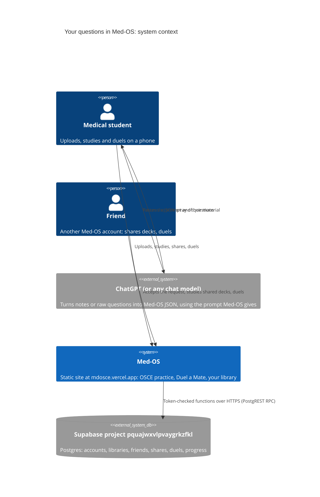
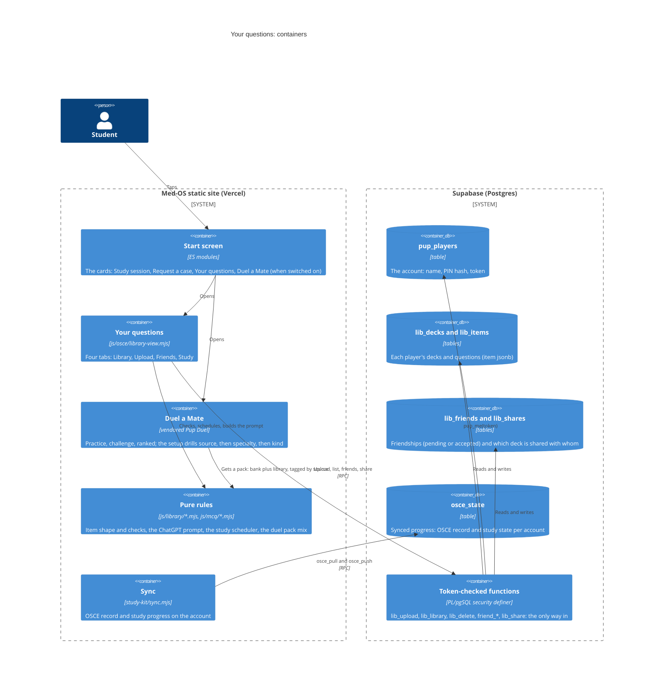
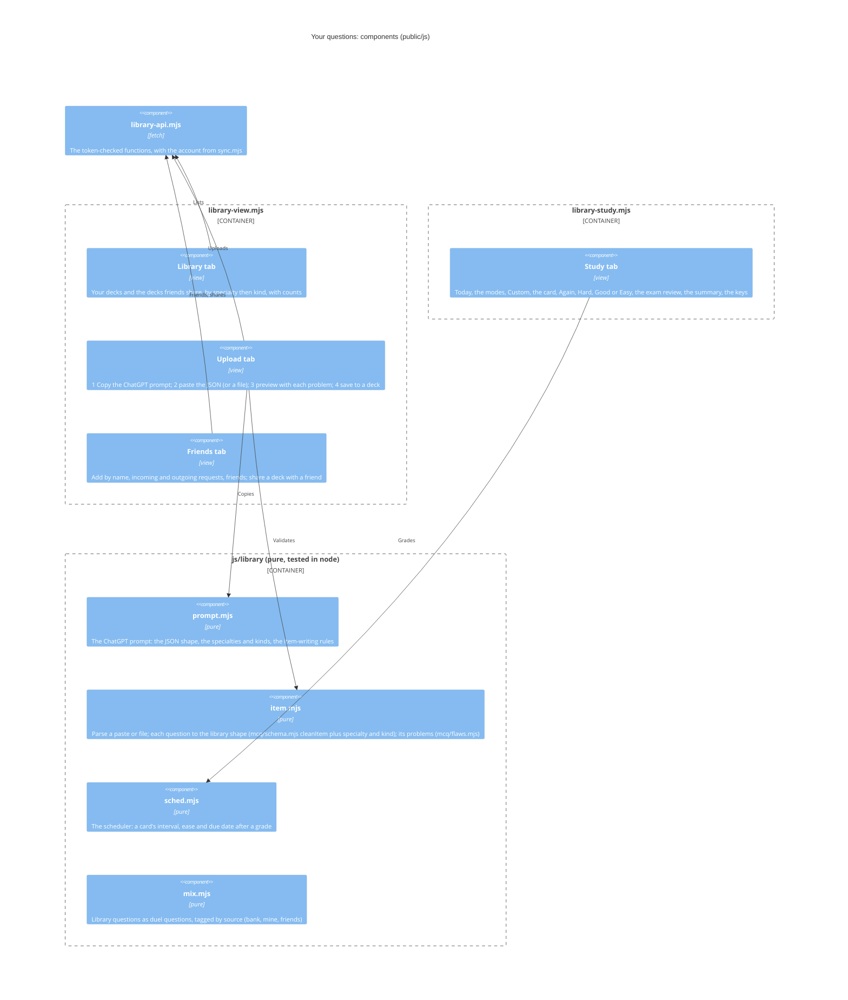
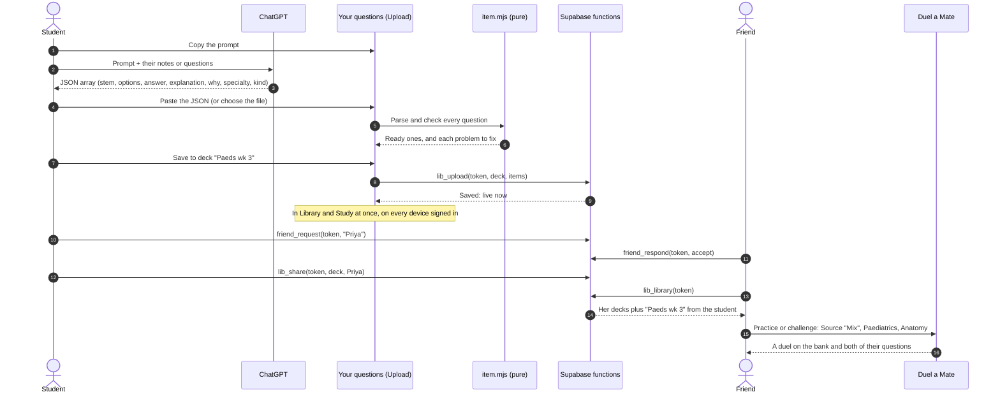

# Your questions: upload, study, share, duel

Founder 2026-10-25: "an entire pipeline for allowing users to upload MCQs, a prompt they can give to ChatGPT to preprocess in the perfect output format with the necessary tagging and drill-down that the MDosce system uses, that they can then upload into the platform to instantly have their MCQs live on the system, have a perfect individual study system built up, and then people can duel with a mix of each other's questions and easily share flashcards with each other, a whole friending system."

This page is the design, in C4 (context, containers, components) and one sequence. The Mermaid diagrams render on GitHub.

## What it adds to what is there

| Already there | Added here |
|---|---|
| **Submit a question** (`osce/mcq-view.mjs`, `mcq_submissions`): a question for the shared pool, reviewed offline before it is used | **Your library**: what you upload is live for you at once, on every device you sign in on, and for the friends you share it with. Sending a question on to the reviewed pool stays an option |
| One account, the duel's name and 4-digit PIN (`pup_players`, Settings → Account) | **Friends** between those accounts: a request by name, then accept or decline |
| The duel's questions in two layers, specialty then kind (`pack.json`) | A **source** layer in front of them: the bank, your questions, your friends' questions, or a mix |
| The MCQ item shape (`mcq/schema.mjs`), its flaw checks (`mcq/flaws.mjs`), JSON or CSV paste (`draftsFrom`) | **A prompt for ChatGPT** that turns any notes or questions into that shape, with the specialty and kind every question needs for the drill-down |
| Progress sync on the account (`osce_pull` and `osce_push`) | **Study**: spaced repetition over your library, the same drill-down, its progress synced like the rest |

## 1. Context

## 2. Containers

## 3. Components of "Your questions"

## 4. From ChatGPT to a duel

## Rules it keeps

- **The account is the duel's.** One name and PIN for the OSCE record, the duel, the library and friends. Every function checks the token (`pup_me`); the tables are closed to the public key.
- **A question stays its writer's.** It shows who wrote it and that it is not reviewed. Sending it to the shared pool goes through the pool's review as before (`mcq_submissions`), never the other way round.
- **Plain text only.** Every surface renders with textContent or `esc()`; an uploaded question can carry no markup.
- **Limits.** 2,000 questions and 50 decks an account, 16 KB a question, 500 a single upload; friends only through accepted requests, so nobody sees a deck that was not shared with them.
- **Phones first.** Every tab works at 320 px with no sideways scroll, in Chromium and WebKit (the e2e runs both).

## 0 to 1: Year 1 to final year

Founder 2026-10-26: "a mode called 0 to 1 ... first year medical content to second year to third year, then final year ... so you can learn from first principles", with the year tagged in the schema.

- **The tag.** Every question carries `year`, 1 to 4 (`public/js/mcq/year.mjs`): 1 first principles (normal structure and function), 2 how it goes wrong (pathology, mechanisms, how drugs work), 3 clinical years (diagnosis, the right test), 4 final year (management, doses, the unwell patient). It is judged by what the question asks, not where the vignette is set.
- **Who sets it.** ChatGPT, through the prompt; for the bank, `scripts/tag-years.mjs` (Claude, kept in `data/mcq/years.json`, merged by `build-duel-pack.mjs`); otherwise `guessYear()`, and an upload says so as a tip.
- **Study.** The bank is a deck you can study too. There are Year chips, and Order is Due first or 0 to 1: five not-yet-learnt cards from each year, Year 1 first, with a banner at each new year.
- **Duel.** Order is Shuffled or 0 to 1 (Pup Duel `makeSetup({ ladder })`). It deals round the years and plays them in year order, and the question's tag shows its year.

## The study ecosystem (2026-10-26)

Founder: "a much more robust personal study ecosystem by researching online how other platforms have it", "minimalist", "engaging". What was borrowed, and from where:

| Feature | From | Where |
|---|---|---|
| FSRS-6 scheduling (90 % retention, one 10-minute step) | Anki; the open SRS benchmark | `library/sched.mjs` |
| Today: a daily goal ring, a streak (today forgiven until it is over), one Start | Duolingo | `library/plan.mjs`, Study home |
| Modes: Smart 10, 0 to 1, your weak spot, got wrong, flagged, Notebook | AMBOSS, UWorld | `plan.mjs` `smart`, `session` |
| Custom session: deck, specialty, kind, year, difficulty; all, unused, incorrect or flagged; size; tutor or timed; order | UWorld, AMBOSS | Custom |
| The grade follows the answer: one big Next | Lecturio, Brainscape | the card |
| How others answered | UWorld, AMBOSS | `0009_mcq_picks.sql` |
| Flags, notes, a Notebook; a nudge for a question that keeps catching you | Anki, UWorld | the card |
| Resume a session; review it at the end; redo the missed | UWorld | the card, the end |
| The exam plan: the day's new questions from your exam date | AMBOSS, RemNote | Study home |
| A heatmap; your gaps by specialty, year and difficulty | Anki, AMBOSS | Your summary |
| The week among friends, effort not scores | Duolingo | Friends, `friend_week` |
| Check the medicine before saving an upload | (49 % of ChatGPT MCQs had flaws, 22 % factual errors) | Upload, `library/verify.mjs` |
| Report a problem with a bank question | everyone | `0010_mcq_reports.sql` |
| A monthly Wrapped, with a story card to post | Spotify | `osce/wrapped-view.mjs` |
| Cross out an option: hold it, right-click, or Shift and its number; a tap brings it back | UWorld, AMBOSS | the card |
| A run of right answers on the Right line, the best run at the end | Duolingo | the card, the end |
| Exam mode: the exam's clock on each question, no answers until the end, then go through them | UWorld (timed, untutored) | Custom, the card |
| Normal ranges beside a question that gives results: its tests first, then 63 adult ranges in nine groups, a find box | UWorld, AMBOSS (lab values) | `library/ranges.mjs`, `osce/ranges-view.mjs` |

The bank Study and the duel draw on is the stations' questions, the reviewed pool, 523 high-yield questions written to 225 topics from the AMC MCQ specification (`scripts/generate-hy.mjs`) and 494 MedExpQA cases (CC BY 4.0, adapted, `scripts/import-medexpqa.mjs`; the set carries some cases more than once, so the pack deals 444: a case with the same answer as one already in is left out, `lib/duel-pack.mjs` `repeatOf`, 2026-10-27); every one tagged by year and difficulty.

Motion everywhere is Apple's springs (`study-kit/spring.mjs`): damping and response, interruptible, velocity handed on; sheets you can drag; presses that give on touch. A page arrives along the path you took: a tab from the side it sits on, a pushed page (Custom, the summary, the Notebook, Upload) from the right with the tabs stepped aside, and back from the left. Nothing grows from nothing: popovers and desktop dialogs open from 95 %, ticks from 40 %.
